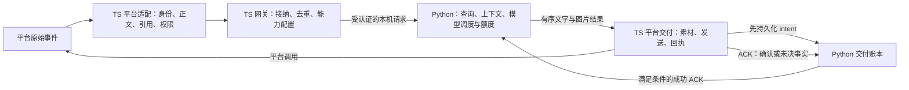

# 多平台机器人契约草案

状态：A3 设计交付，**多平台接入未实施**。本文按 `8af04e231d70d5ad97765cadd59eae85d6271485` 的业务与协议核对，现行载荷仍为 **2.0**、HTTP 路径仍为 **`/v1`**、能力仍为 `qq-query-chat-v3`；本批不修改这些值，也不据源码推定线上运行版本。

目标是让 Taki 与未来独立运营的 Haneoka 机器人复用业务代码，并明确接入第二个平台前必须处理的差异。首版继续采用一个受管网关、一个业务状态持有者；第二平台尚未选定，不声明多网关或多后端扩容能力。

## 职责与数据流

业务核心复用 `QuerySpec`、`QueryResult`、`CommandResult` 和现有回复准备，不依赖 SDK 消息对象。平台适配层负责可信身份、原始正文、平台权限及实际发送；后端负责数据、业务状态、执行许可和持久事实。模型输出、昵称和普通格式化消息都不能提供可信身份。

## 身份与状态键

以下元组表示逻辑作用域，**不是新增 wire schema**。本次不重新计算或迁移已有标识。

| 用途 | 当前 QQ 实现 | 多平台所需边界 |
|---|---|---|
| 实例与应用 | 后端固定 `instance_id/app_id`；账本 namespace 为两者以 `\0` 连接 | 应用身份包含 `(instance_id, platform, app_id)`；平台应用 ID 与机器人自身 ID 分开，不能把同数字当同应用 |
| 请求去重 | `request_id=SHA256([instance,app,'qq',kind,conversation,user,message])`；摘要覆盖请求内容与入场策略，排除 gateway epoch／ingress seq | 保留全作用域及原消息标识；同 ID 同摘要读原事实，冲突摘要拒绝；不同平台、应用、会话之间不碰撞 |
| 接纳高水位 | `context_id=SHA256([instance,app,platform,kind,conversation,user])`；比较该键的 `ingress_seq`；换 gateway epoch 清空高水位 | 继续区分接纳顺序与话题锁；不能因改成多平台而加入全用户交付队列；单网关统一拥有接纳代次 |
| 话题与引用 | 新话题用 `ContextKey(platform,kind,conversation,request_id)`，末字段虽名为 `user`，此入口放的是请求 ID；锚点键为 `(scope,已确认回复message_id)` | 话题、快照与锚点必须受实例／平台／应用／会话共同约束；同会话可引用已确认话题，跨作用域不能继承 |
| 群策略与许可 | `group-policies.v1.json` 绑定 QQ／应用／实例，群项以 conversation ID 索引；入场策略含 epoch 和全局／群 revision | 按完整会话作用域保存策略；每次模型调用重查当前权限，绑定 request、attempt、nonce、双方 epoch、scope 和 user，不扩大入场许可 |
| AI 用户调度 | 原生模型使用 `UsageLedger.key('user', subject)`；旧后端路径仍用 `(kind,conversation,user)` | 默认按平台应用内的可信身份隔离；保留已核验的显式 subject 关联，不凭昵称、头像或裸 ID 合并用户 |
| 额度与频率 | 用量库绑定实例／应用并持有独立盐；用户键来自 subject，群键为 `key('group',conversation_id)`；以 UTC+8 的实际 started 日期结算 | 用户与群键必须包含完整平台／应用作用域；沿用 reserve/start/settle 和未知用量处理；键变化须有保留历史额度的迁移方案 |

原生模型的 subject 已支持两种来源：管理员登记的显式绑定，以及明确准入群中由 `group_subject(instance_id,app_id,conversation_id,user_id)` 派生的身份。显式绑定优先，未绑定私聊不自动获准；不能沿用包 1 的暂行描述，将所有模型路径都写成会话／用户元组。未来跨平台账号关联属于独立功能，须有身份核验与批准记录。

Taki 与 Haneoka 分别拥有配置、凭据、管理权限、状态目录、额度账本、素材所有权和发布节奏；共用代码与协议不建立公共用户库。后端继续使用认证 loopback 接口，多平台本身不要求公网 API。

## QQ 与平台无关契约的差异

| 边界 | 当前 QQ 行为 | 第二平台适配要求 |
|---|---|---|
| 入站场景 | 只接受 `platform='qq'` 与 group/c2c；c2c 的 conversation ID 必须等于 user ID | 登记该平台的场景及真实 ID 作用域，按已验收 profile 校验；不照搬 QQ 私聊等式 |
| 正文／引用／按钮 | 原始事件提供正文；`reference` 须匹配后端允许的 adapter profile；当前网关不接入引用，按钮拒绝 | 分别登记可信来源和 adapter 版本；能力未核验时保持关闭，普通文本不能伪装引用或按钮事件 |
| 输出结果 | 有序 `parts`，文字或图片，携带 position、片段 ID、业务状态；图片通过受限二进制接口取得 | 业务结果保持有序；平台适配决定提及、编码、分片和上传方式，不将 SDK 对象或图片 Base64 塞回业务结果 |
| 回复预算 | 本地候选限制为 5 次发送、298 秒被动回复窗口、图片 3,000,000 字节、最终文字 1,800 字符；群准备阶段留到 1,500 字符给提及 | profile 明确计量单位、回复期限、发送名额与图片限制；先计入提及、处理提示和回退，再检查总预算。这里的 QQ 数值是源码约束，不充当官方额度证明 |
| 素材 | 群图片走受 App ID 隔离的素材租约；私聊走文件上传；素材回执与消息回执独立 | 登记上传入口、MIME／尺寸／字节上限、素材期限、复用作用域、删除权限与超时；上传成功不等于消息已发送 |
| 发送 | QQ `msg_id/msg_seq`、Markdown 提及和素材 URL 由 QQDelivery 持有；同消息只有一个发送所有者 | 目标平台实现自己的顺序和幂等语义，不模拟不存在的 QQ 字段；主动通知与被动回复分别核验权限和预算 |
| 执行许可 | 挑战最多 3 秒、许可最多 1 秒；网关准备期继续获取许可 | 平台等待／上传不能阻断许可处理；平台回复截止时间和模型执行截止时间分别约束，禁止把一种期限当另一种 |

每份计划保留 `request_id/delivery_id/plan_version/expires_at/send_allowed` 及有序片段；业务 `success/no_result/...` 与运输结果分开。适配层在**持久 intent 确认后**才发送，再提交 ACK：

- `success`：平台明确返回可绑定的消息标识；可在上下文仍有效时建立锚点，不表示客户端已经看到或已读。
- `failure`：平台明确拒绝本次发送；保留事实，不自动当作可重试。
- `uncertain`：网络结果不明、缺回执或审核待定；保留未决记录和所有权，不盲目重发。
- `aborted` 与 `upload_failed` 继续区分本地未发送和上传失败；上传失败可走既有受控文字回退，未决发送不能走同样的重发路径。

同消息保持片段／intent／发送／ACK 顺序；同话题保留依赖锁，独立请求可并行。固定页面与 Meta 已捕获详情沿用原绝对期限和可见范围，实体详情继续执行原来源版本检查。引用只绑定成功 ACK 的真实回复 ID，读取、翻页和新 ACK 不延长原内容寿命。

## 后续代码改造与成对发布

1. **应用登记和能力配置**：替换目前只允许 QQ 的校验、单个 `app_id` 绑定和单 QQ 能力常量；将上表平台约束收拢到有来源、有版本的 profile。QQ 回复窗口、群文字预留和片段上限分布在后端与网关，双方都须使用已登记的能力生成／校验结果，不能只改 TS 的 platform 字符串；请求不能自行声明更大权限或预算。
2. **状态命名空间**：逐项处理交付／额度 namespace、group subject、群策略文件、素材目录、上下文和通知目标。一个实例接入多个应用前，先验证所有键的应用隔离；已有 QQ 账本及历史额度保持可追溯，不能通过改哈希或重建库清零。
3. **网关生命周期**：仍由一个受管网关登记一个 active epoch；当前注册新 epoch 会退休旧代次并终止旧工作。增加平台适配器不新增第二个网关进程来抢占同一后端，也不引入共享写者。
4. **协议与回退**：现有请求采用严格字段与精确版本校验。实际新增字段／能力时更新配对网关、后端、组合清单和源码摘要，并测试不兼容组合明确拒绝；本草案不预先分配下一协议版本。停止接纳后按既有流程收尾／撤销旧 epoch，再切换完整组合；旧 ACK 只按已支持契约记事实，不能恢复失效上下文。
5. **持久兼容**：发布前验证旧版对新状态的读取与接纳能力；schema 可读不代表容量或身份键可回退。沿用既有更新器和受信控制器，不删除账本、未知记录或额度来完成回退。

## 第二平台的开工与验收入口

平台选定后，为对应 profile 填入官方文档链接、核对日期、adapter 版本和实测记录；在这些材料齐全前，以下均为待验收，不配置真实账号或开放该能力。

| 验收项 | 必须确认的事实与场景 |
|---|---|
| 身份与触发 | 应用／机器人／用户／会话／原消息 ID 作用域；群／私聊触发、重复事件、乱序事件、跨平台相同 ID 隔离 |
| 权限与身份关联 | 初次接纳、等待后撤权、群策略暂停、每次模型许可；相同昵称不同账号不共用上下文或额度 |
| 回复与素材 | 文字、图片、混合顺序、完整分页、超限回退；上传复用和失效；回复窗口、主动通知及平台拒绝 |
| 引用与交互 | 可信引用字段、可见性、同会话锚点、跨会话拒绝；按钮若未验证则明确不支持 |
| 故障与恢复 | intent 回应丢失、发送回执丢失、ACK 重复／迟到、卸载、重启、旧 epoch；不二次业务执行或未知重发 |
| 发布与隔离 | QQ 等价回归、新旧组合拒绝／回退、Taki/Haneoka 状态与额度隔离；分别记录离线测试、部署版本、平台接受回执、客户端显示 |

源码依据：[请求与作用域](../src/ournotes_bot/application/backend_protocol.py)、[接纳与话题键](../src/ournotes_bot/application/backend.py)、[锚点与快照](../src/ournotes_bot/application/conversation_state.py)、[模型身份配置](../src/ournotes_bot/application/model_config.py)、[原生模型调度](../src/ournotes_bot/application/model_runtime.py)、[用量账本](../src/ournotes_bot/application/usage_ledger.py)、[QQ 入站](../koishi/src/ingress.ts)、[QQ 交付](../koishi/src/delivery.ts)、[素材所有权](../koishi/src/materials.ts)、[群策略](../koishi/src/group-policies.ts)。现有契约详见[包 1](QUERY_CHAT_PACKAGE1.md)与[包 3](QUERY_CHAT_PACKAGE3.md)。
